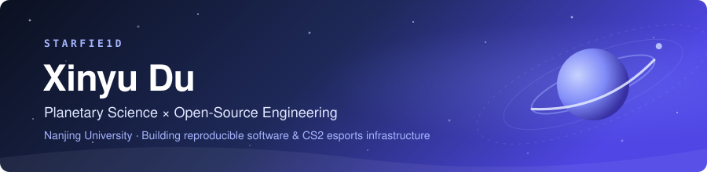
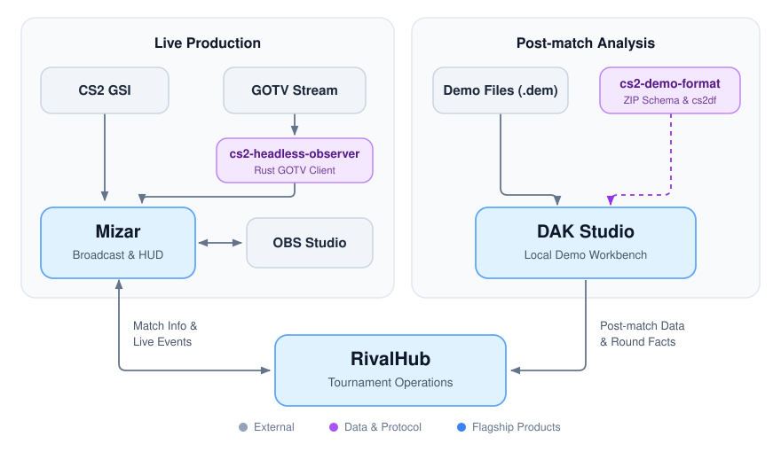

  

  
  
  
  

<table>
  <tr>
    <td width="50%" valign="top">
      <b>🧪 Science · 行星科学与科学计算</b> 
      Planetary Science undergraduate (Chemistry track) at NJU, exploring planetary chemistry, astrobiology &amp; reproducible scientific computing. 
      <a href="https://github.com/Starfie1d1272/conop9-penalty-validation">CONOP9</a> · <a href="https://github.com/Starfie1d1272/planetary-geochemistry-coursework">Coursework</a>
    </td>
    <td width="50%" valign="top">
      <b>⚡ Engineering · 开源软件与工具链</b> 
      Building CS2 esports infrastructure for real collegiate tournaments, cross-platform indie apps &amp; AI Agent workflows.
    </td>
  </tr>
</table>

## 🔨 Featured Projects · 精选项目

<table>
  <tr>
    <td width="50%" valign="top">
      <a href="https://github.com/Starfie1d1272/RivalHub"><b>RivalHub</b></a> 
      赛事运营平台 · <a href="https://match.starfie1d.top">Live Website ↗</a> 
      
       
      Collegiate esports platform powering live NJU tournaments, from registration to match statistics.
    </td>
    <td width="50%" valign="top">
      <a href="https://github.com/Starfie1d1272/Mizar"><b>Mizar</b></a> 
      赛事制播系统 
      
       
      All-in-one Windows CS2 broadcast studio with OBS automation, HUD, radar &amp; observer cues.
    </td>
  </tr>
  <tr>
    <td width="50%" valign="top">
      <a href="https://github.com/Starfie1d1272/cs2-demo-analysis-kit"><b>DAK Studio</b></a> 
      本地录像分析 
      
       
      Local-first CS2 demo analysis workbench with 2D replay and round/tick traceability.
    </td>
    <td width="50%" valign="top">
      <a href="https://github.com/Starfie1d1272/cs2-headless-observer"><b>cs2-headless-observer</b></a> 
      无头 GOTV 客户端 · Rust 
      
       
      Headless Windows CS2 GOTV client streaming live match events as JSON without the game renderer.
    </td>
  </tr>
  <tr>
    <td width="50%" valign="top">
      <a href="https://github.com/Starfie1d1272/send-to-myself"><b>SendToMyself</b></a> 
      发给自己 · 跨端个人信息流 
      
       
      Self-hosted personal inbox across Web, Desktop &amp; HarmonyOS for notes, links, files &amp; tasks.
    </td>
    <td width="50%" valign="top">
      <a href="https://github.com/Starfie1d1272/Cexing"><b>Cexing</b></a> 
      策星 · HarmonyOS 原生客户端 
      
       
      Native HarmonyOS proxy client pairing ArkUI daily controls with Mihomo Smart &amp; Zashboard.
    </td>
  </tr>
</table>

### 🔗 CS2 Ecosystem · 赛事工具链

  <picture>
    <source media="(prefers-color-scheme: dark)" srcset="./profile/cs2-ecosystem-dark.svg">
    
  </picture>

<b>📦 More Projects &amp; Research · 延伸项目（CS2 数据研究 / AI Agent / 科研计算）</b>

- **CS2 Data & Libraries**: [cs2-demo-format](https://github.com/Starfie1d1272/cs2-demo-format) · [rival-rating](https://github.com/Starfie1d1272/rival-rating) · [cs2-roundsense](https://github.com/Starfie1d1272/cs2-roundsense) · [cs2-c4-damage](https://github.com/Starfie1d1272/cs2-c4-damage) · [CS2-Pro-Settings](https://github.com/Starfie1d1272/CS2-Pro-Settings)
- **AI Agent & Context**: [dsh-github-skills](https://github.com/Starfie1d1272/dsh-github-skills) · [dsh-v4-anchor](https://github.com/Starfie1d1272/dsh-v4-anchor) · [personal-context](https://github.com/Starfie1d1272/personal-context)
- **Science & Computation**: [conop9-penalty-validation](https://github.com/Starfie1d1272/conop9-penalty-validation) · [planetary-geochemistry-coursework](https://github.com/Starfie1d1272/planetary-geochemistry-coursework)

---

### 🧰 Tech Stack & Activity · 技术栈与动态

  
  
  
  
  
   
  
  
  
  
  
  
  

  <picture>
    <source media="(prefers-color-scheme: dark)" srcset="./profile/stats-dark.svg">
    
  </picture>
  <picture>
    <source media="(prefers-color-scheme: dark)" srcset="./profile/top-langs-dark.svg">
    
  </picture>

  <picture>
    <source media="(prefers-color-scheme: dark)" srcset="./profile/snake-dark.svg">
    
  </picture>

<table>
  <tr>
    <td width="62%" valign="middle">
      <b>🪐 Find me elsewhere</b> 
      
      
       
      Nanjing, China
    </td>
    <td width="38%" valign="middle" align="right">
       
      Profile Views
    </td>
  </tr>
</table>
